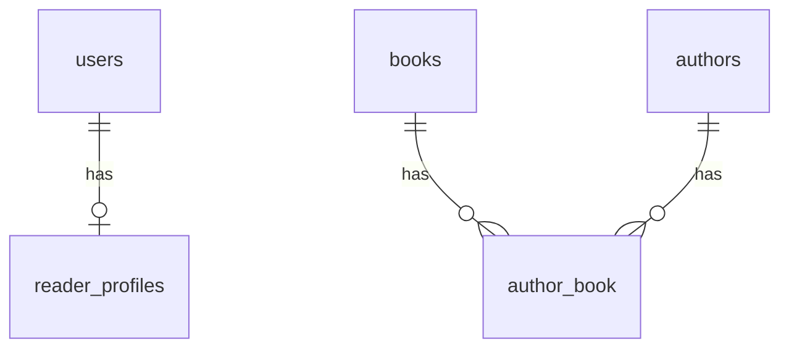

# Library setup guide

## Environment

- Laragon on Windows
- PHP 8.3.33
- MySQL 8.4.3
- Laravel 12 (install the versions in composer.lock)
- Composer

Open Laragon Terminal. Check `php -v` and `mysql --version` before setup.

## Installation

```powershell
git clone https://github.com/nguyenducchinh0209/thu-vien-may.git
cd thu-vien-may
git switch phu/database-model-foundation
composer install
if (!(Test-Path .env)) {
    Copy-Item .env.example .env
    php artisan key:generate
}
```

If .env already exists, preserve it and edit its database settings instead of copying over it.
Start MySQL in Laragon. Create an empty development database using HeidiSQL or the MySQL client:

```sql
CREATE DATABASE thu_vien_may CHARACTER SET utf8mb4 COLLATE utf8mb4_unicode_ci;
```

Configure .env for your local credentials:

```dotenv
DB_CONNECTION=mysql
DB_HOST=127.0.0.1
DB_PORT=3306
DB_DATABASE=thu_vien_may
DB_USERNAME=root
DB_PASSWORD=
```

An empty password is only an example for a local installation. Use your actual credentials.

```powershell
php artisan config:clear
php artisan migrate --seed
php artisan serve --host=127.0.0.1 --port=8000
```

Open http://127.0.0.1:8000. The current frontend serves CSS/JavaScript from public/library; npm is not needed for that frontend.
For a Laragon virtual host, set the document root to this project's public directory.

## Demo accounts

Use these accounts only in a local development database.

| Role | Email | Password |
| --- | --- | --- |
| Admin | admin@library.vn | admin12345 |
| Librarian | thuthu@library.vn | thuthu123 |
| Reader | minhanh@example.com | docSach123 |

Repeated seeding preserves existing accounts, passwords and catalog records. Demo book titles and authors are fictional.

## Database and models

- User: existing login fields, name and role. Existing role values remain Admin, Thủ thư and Độc giả for compatibility. Reader accounts are soft-deleted so future loan history remains linked.
- ReaderProfile: one per reader, unique user_id and reader_code, optional phone, address, date_of_birth and avatar_path. The full name remains in users.name to avoid duplicate data.
- Author: name, optional biography; soft deletion.
- Book: unique book_code, title, optional unique ISBN, description, publisher, publication_year, edition and cover_image_path; total_quantity and rental_fee in VND; soft deletion.
- author_book: many-to-many relation; composite primary key prevents duplicate links.

Relations: User::readerProfile(), ReaderProfile::user(), Book::authors(), Author::books().
Reader codes are generated from the unique user ID as RD000001; gaps are expected.
New reader accounts created through Eloquent automatically receive a profile. Registration writes both records in one transaction. The migration also creates profiles for existing readers.
Create reader accounts through Eloquent, with the reader role set at creation; raw inserts and later role changes do not create profiles automatically.
Book codes such as BK000001 identify a title/edition, not an individual physical copy. Supply a unique code when creating a book and retain it when editing its title. Handle duplicate-code validation in the CRUD endpoint; never generate codes by counting rows.
A different edition gets a separate record. total_quantity counts all physical copies of the title. rental_fee is the per-copy fee for a 14-day loan; store it as a decimal, not a float.
Validate nonnegative quantity/fee, field lengths, ISBN uniqueness and sensible publication years in CRUD requests. Do not expose profile identifiers for mass assignment.
Foreign keys restrict hard deletion of linked records. Soft-deleting books/authors preserves links. Normal relationship queries exclude soft-deleted catalog records.



## Scope

This foundation contains accounts, reader profiles, authors, books and sample data. Existing authentication and frontend are retained. Staff-only JSON CRUD endpoints are available for books, authors and readers under `/staff`; the frontend catalog and staff screens still need to be connected to them.

Staff catalog and reader endpoints require authentication and the `Admin` or `Thủ thư` role. All list endpoints support `q` search and pagination using `page` and `per_page` (maximum 50):

- Books: `/staff/books` — search title, code, ISBN, publisher or author; create/update accepts `author_ids` and an optional `cover_image` upload.
- Authors: `/staff/authors` — search by name; deleting an author is soft deletion and preserves its book links.
- Readers: `/staff/readers` — search name, email, reader code or phone; create requires a confirmed password and always assigns the `Độc giả` role. Optional avatar uploads use the `avatar` field. Deleting a reader is soft deletion; profile and future history are retained.
- Loans: `/staff/loans` — staff issue a 14-day loan to a reader with one or more book quantities. `POST /staff/loans/{id}/returns` records full or partial returns and keeps each return event in history.
- Inventory: `GET /staff/inventory` — lists total, currently-on-loan and available copy counts. Availability subtracts copies that have not yet been returned on active loans.
- Public catalog: `GET /catalog/books` and `GET /catalog/books/{id}` — public search/details with author and rating summary.
- Reader loan history: `GET /my/loans` — a reader's loans, return history and current overdue indicator.
- Reader cart: `/my/cart` and `/my/cart/items` support listing, adding, updating and removing items. `POST /my/cart/reservations` submits all cart items as queued reservations atomically and clears the cart only on success.
- Reservations: readers use `POST /reservations`, `GET /my/reservations` and `DELETE /reservations/{id}`. Staff use `/staff/reservations`; approve with `POST /staff/reservations/{id}/ready`, then issue the loan with `POST /staff/reservations/{id}/fulfill`. Requests are queued FIFO per title; an approved quantity is held for 3 days.
- Fines: `GET /my/fines` for readers; staff list via `GET /staff/fines`. A late return creates an unpaid fine at 1,000 VND per returned copy per late calendar day. Admins may waive an unpaid fine with a reason. Payment capture/history is intentionally left for the payment integration.
- Reviews and comments: `GET /books/{id}/reviews`, `GET /books/{id}/comments`; signed-in readers can post, edit or delete their own review and post/delete their own comments. Ratings publish immediately and one review per reader per book is allowed.
- Book suggestions: readers use `POST /book-suggestions` and `GET /my/book-suggestions`; staff list at `/staff/book-suggestions` and update status to `approved`, `rejected` or `ordered`.

For browser access to uploaded book covers and reader avatars, run `php artisan storage:link` once per local setup.
The scheduled `reservations:expire` command marks ready holds past their 3-day pickup window as expired. Run Laravel's scheduler in deployment (for local testing, `php artisan schedule:work`). Current inventory subtracts both outstanding copies on active loans and non-expired ready reservations from `total_quantity`.

## Verification

```powershell
php artisan test
```

The default automated suite uses an isolated SQLite in-memory database. For MySQL integration testing, create a separate empty database named thu_vien_may_test and configure .env.testing with its credentials. Never point tests at a database containing real data: RefreshDatabase recreates tables.
Run the following from Laragon Terminal to override the SQLite test defaults:

```powershell
$env:DB_CONNECTION='mysql'
$env:DB_DATABASE='thu_vien_may_test'
php artisan test
Remove-Item Env:DB_CONNECTION
Remove-Item Env:DB_DATABASE
```

Use `php artisan migrate` for additive updates. Do not use migrate:fresh on a database whose data must be retained. Keep .env, vendor and runtime database files out of Git.
